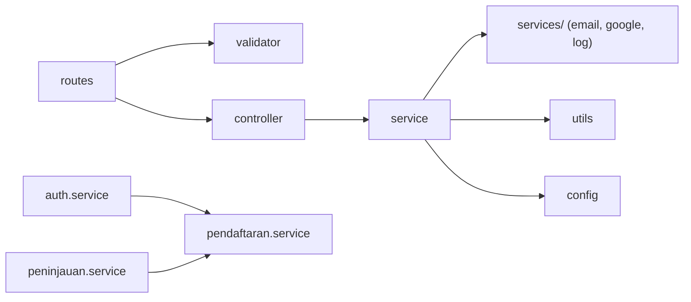
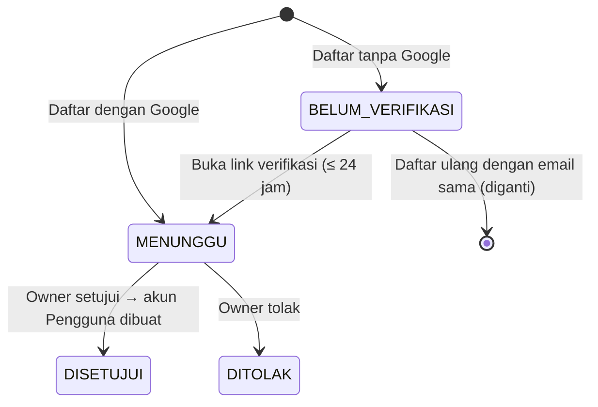
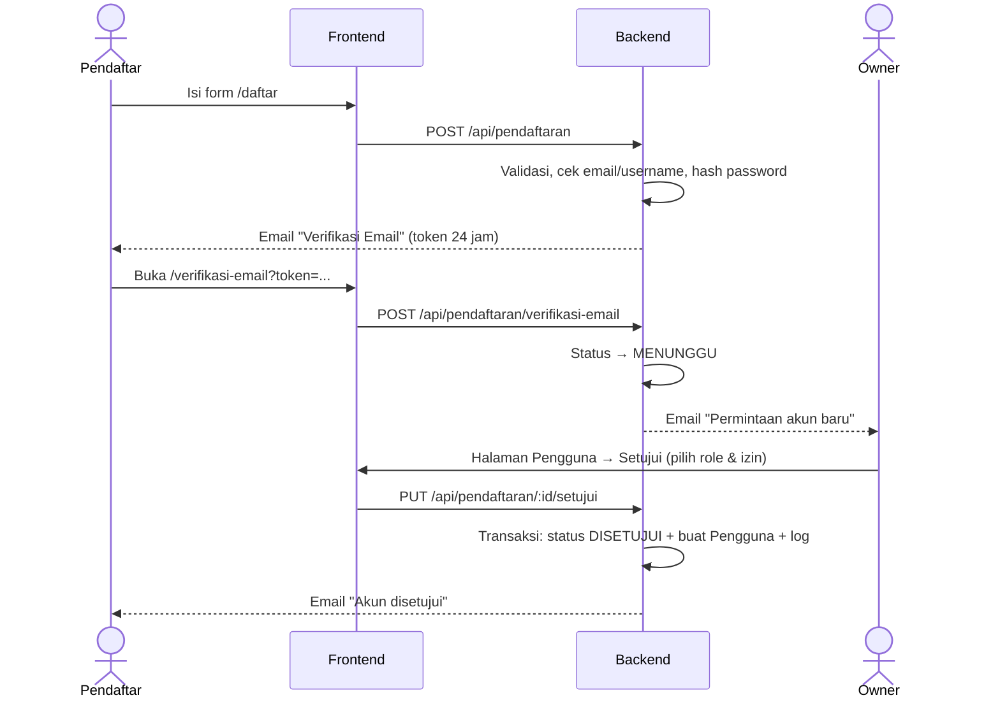

# Autentikasi & Pendaftaran Akun — FinStocks

Dokumen ini menjelaskan cara kerja login, pendaftaran akun dengan persetujuan owner, lupa password, dan aturan password. Bacalah sebelum mengubah file di `backend/src/modules/auth`, `backend/src/modules/pendaftaran`, atau `frontend/src/pages/auth`.

## Daftar Isi

1. [Ringkasan Fitur](#1-ringkasan-fitur)
2. [Arsitektur & Struktur Folder](#2-arsitektur--struktur-folder)
3. [Alur Proses](#3-alur-proses)
4. [Endpoint API](#4-endpoint-api)
5. [Skema Database](#5-skema-database)
6. [Konfigurasi](#6-konfigurasi)
7. [Keputusan Keamanan](#7-keputusan-keamanan)
8. [Panduan Mengembangkan](#8-panduan-mengembangkan)
9. [Pengujian Manual](#9-pengujian-manual)

---

## 1. Ringkasan Fitur

| Fitur | Keterangan |
|---|---|
| Login | Satu kolom yang menerima **email atau username**, ditambah password. |
| Masuk dengan Google | Tombol resmi Google Identity Services. Login hanya berhasil jika email Google sudah terdaftar pada akun yang aktif. |
| Daftar akun | Siapa pun bisa mengajukan, tetapi **akun baru hanya dibuat setelah owner menyetujui**. |
| Verifikasi email | Pendaftar tanpa Google harus membuka link di email (berlaku 24 jam) sebelum permintaannya sampai ke owner. |
| Persetujuan owner | Owner (superadmin) melihat antrean di halaman **Pengguna**, lalu menyetujui (sambil memilih role & izin) atau menolak (dengan alasan opsional). |
| Lupa password | Link reset dikirim ke email (berlaku 30 menit, sekali pakai). |
| Aturan password | **8–16 karakter**, minimal **1 huruf besar** dan **1 angka**. |
| Notifikasi email | Verifikasi, pendaftaran baru (ke owner), akun disetujui/ditolak, link reset, dan pemberitahuan password diubah. |

---

## 2. Arsitektur & Struktur Folder

### Prinsip

- **Satu fungsi, satu tugas.** Fungsi orkestrator (mis. `ajukanPendaftaran`) hanya merangkai fungsi-fungsi kecil yang masing-masing mengerjakan satu hal.
- **Lapisan tipis di luar, logika di service.** Alurnya `routes → validator → controller → service`. Controller hanya membaca request dan mengirim respons.
- **Kode bersama ada di `services/`, `utils/`, dan `config/`.** Modul tidak saling menyalin kode.
- **Error memakai `AppError`.** Service melempar `new AppError(status, pesan, kode)`, lalu `asyncHandler` mengubahnya menjadi respons JSON standar.

### Backend

```
backend/src/
├── config/
│   ├── auth.config.js          # Angka keamanan: bcrypt rounds, masa berlaku token
│   └── permissions.js          # Daftar fitur & tentukanIzinAkses() (dipakai juga oleh seed)
├── middlewares/
│   ├── validate.middleware.js  # Menjalankan aturan express-validator → 422
│   └── rateLimit.middleware.js # loginLimiter, pendaftaranLimiter, lupaPasswordLimiter
├── services/                   # Layanan lintas modul
│   ├── email/
│   │   ├── mailer.js           # Satu-satunya file yang berbicara dengan SMTP
│   │   ├── layout.js           # Membangun versi teks & HTML dari satu struktur konten
│   │   └── templates.js        # Isi tiap jenis email
│   ├── notifikasi.service.js   # SIAPA menerima email & KAPAN (per kejadian)
│   ├── googleAuth.service.js   # Verifikasi ID token Google
│   └── logAktivitas.service.js # catatAktivitas()
├── utils/
│   ├── AppError.js             # Error terkontrol { status, message, code }
│   ├── asyncHandler.js         # Pembungkus controller (tanpa try/catch berulang)
│   ├── passwordPolicy.js       # Aturan kekuatan password + validator
│   ├── password.js             # hashPassword / verifyPassword (bcrypt)
│   ├── token.js                # generateToken / hashToken (SHA-256)
│   └── email.js                # normalisasiEmail
└── modules/
    ├── auth/
    │   ├── auth.routes.js      # /api/auth/*
    │   ├── auth.validator.js
    │   ├── auth.controller.js
    │   ├── auth.service.js     # login, loginGoogle, getMe
    │   ├── auth.session.js     # buatSesi (JWT + log), toPublicUser
    │   └── password.service.js # forgotPassword, resetPassword
    └── pendaftaran/
        ├── pendaftaran.routes.js
        ├── pendaftaran.validator.js
        ├── pendaftaran.controller.js
        ├── pendaftaran.service.js  # Sisi pendaftar: ajukan + verifikasi email
        └── peninjauan.service.js   # Sisi owner: daftar, setujui, tolak
```

**Arah ketergantungan** (panah berarti "memakai"):



Modul `auth` memanggil `pendaftaran.service.tolakJikaPendaftaranDiproses()` agar pendaftar yang belum disetujui mendapat pesan yang jelas saat mencoba login. Ketergantungan hanya ke satu arah: `pendaftaran` tidak pernah memanggil `auth`.

### Frontend

```
frontend/src/
├── api/
│   ├── authApi.js              # login, loginGoogle, forgotPassword, resetPassword
│   └── pendaftaranApi.js       # ajukan, verifikasi, getPendaftaran, setujui, tolak
├── constants/permissions.js    # DAFTAR_FITUR, FITUR_DEFAULT_KARYAWAN
├── hooks/useGoogleIdentity.js  # Memuat script Google, status disabled/loading/ready/error
├── utils/
│   ├── passwordPolicy.js       # Cermin aturan password backend (untuk umpan balik langsung)
│   ├── apiError.js             # getErrorMessage, getErrorCode
│   └── googleIdentity.js       # Pemuat script + readGoogleProfile
├── components/
│   ├── auth/                   # AuthLayout, AuthCard, AuthTextField, PasswordField,
│   │                           # PasswordChecklist, GoogleSignInButton, AuthStatus, dll.
│   ├── pengguna/               # PermintaanAkunPanel, Setujui/TolakPendaftaranModal,
│   │                           # IzinAksesCheckboxes, StatusPendaftaranBadge
│   └── layout/GuestRoute.jsx   # Mengarahkan pengguna yang sudah login keluar dari halaman tamu
└── pages/auth/
    ├── Login.jsx               # /login
    ├── Daftar.jsx              # /daftar
    ├── LupaPassword.jsx        # /lupa-password
    ├── ResetPassword.jsx       # /reset-password?token=...
    └── VerifikasiEmail.jsx     # /verifikasi-email?token=...
```

Semua halaman auth dirender di dalam `AuthLayout` (panel branding + konten). `/login`, `/daftar`, dan `/lupa-password` juga dibungkus `GuestRoute`.

---

## 3. Alur Proses

### 3.1 Status pendaftaran



### 3.2 Pendaftaran tanpa Google



### 3.3 Pendaftaran dengan Google

Pendaftar menekan **Daftar dengan Google** di `/daftar`, atau menekan **Masuk dengan Google** di `/login` dengan akun yang belum terdaftar (otomatis diarahkan ke `/daftar`). Nama dan email terisi dari akun Google, dan email tidak bisa diubah. Pendaftar tinggal memilih username dan password. Server memverifikasi credential Google dan memastikan emailnya sama, lalu status langsung menjadi **MENUNGGU** tanpa email verifikasi.

### 3.4 Login

`POST /api/auth/login` dengan `identifier`:

- Jika berisi `@`, dicari sebagai **email** (tidak peka huruf besar/kecil).
- Jika tidak, dicari sebagai **username**.

Jika akun tidak ditemukan tetapi ada pendaftaran yang masih diproses **dan password-nya cocok**, server menjelaskan statusnya (`EMAIL_NOT_VERIFIED` atau `REGISTRATION_PENDING`). Selain itu, pesannya selalu "Email/username atau password salah".

`POST /api/auth/google` mencari akun berdasarkan `googleId`, lalu berdasarkan email. Pada login Google pertama, `googleId` ditautkan ke akun tersebut.

### 3.5 Lupa password

1. `/lupa-password` → `POST /api/auth/forgot-password`. Respons **selalu sama**, baik email terdaftar maupun tidak.
2. Jika email milik akun **AKTIF**, hash token disimpan di `Pengguna.resetTokenHash` dan link dikirim ke email.
3. `/reset-password?token=...` → `POST /api/auth/reset-password`. Password diganti, token dihapus, log dicatat, dan email pemberitahuan dikirim.

---

## 4. Endpoint API

Semua respons memakai format `{ success, message, data?, error? }`. Untuk respons validasi (422), `message` berisi pesan error pertama dan `details` berisi semua error.

### Auth — `/api/auth`

| Method | Endpoint | Body | Akses | Rate limit |
|---|---|---|---|---|
| POST | `/login` | `{ identifier, password }` | Publik | 10 gagal / 15 menit / IP |
| POST | `/google` | `{ credential }` | Publik | sama dengan login |
| POST | `/forgot-password` | `{ email }` | Publik | 5 / 15 menit / IP |
| POST | `/reset-password` | `{ token, password }` | Publik | – |
| POST | `/logout` | – | Login | – |
| GET | `/me` | – | Login | – |

### Pendaftaran — `/api/pendaftaran`

| Method | Endpoint | Body / Query | Akses |
|---|---|---|---|
| POST | `/` | `{ nama, email, username, password, googleCredential? }` | Publik (5 / 15 menit / IP) |
| POST | `/verifikasi-email` | `{ token }` | Publik |
| GET | `/` | `?status=MENUNGGU\|DISETUJUI\|DITOLAK\|SEMUA` | OWNER |
| PUT | `/:id/setujui` | `{ role?, permissions? }` | OWNER |
| PUT | `/:id/tolak` | `{ alasan? }` | OWNER |

### Kode error penting

| Kode | Status | Arti |
|---|---|---|
| `INVALID_CREDENTIALS` | 401 | Email/username atau password salah |
| `ACCOUNT_DISABLED` | 403 | Akun dinonaktifkan owner |
| `EMAIL_NOT_VERIFIED` | 403 | Pendaftar belum membuka link verifikasi |
| `REGISTRATION_PENDING` | 403/409 | Pendaftaran menunggu persetujuan owner |
| `GOOGLE_NOT_REGISTERED` | 404 | Akun Google belum terdaftar (frontend mengarahkan ke `/daftar`) |
| `GOOGLE_NOT_CONFIGURED` | 503 | `GOOGLE_CLIENT_ID` belum diisi di backend |
| `GOOGLE_TOKEN_INVALID` | 401 | Credential Google palsu/kedaluwarsa |
| `EMAIL_EXISTS` / `USERNAME_EXISTS` | 409 | Sudah dipakai |
| `VERIFICATION_INVALID` / `VERIFICATION_EXPIRED` | 400 | Link verifikasi tidak berlaku |
| `RESET_TOKEN_INVALID` | 400 | Link reset tidak berlaku |
| `EMAIL_SEND_FAILED` | 502 | SMTP gagal; pendaftaran dibatalkan agar bisa diulang |
| `TOO_MANY_REQUESTS` | 429 | Kena rate limit |

---

## 5. Skema Database

Migrasi: `backend/prisma/migrations/20261004120000_auth_pendaftaran`.

**`Pengguna`** (kolom baru)

| Kolom | Keterangan |
|---|---|
| `email` (unik, opsional) | Untuk login, Google, dan lupa password. Owner bisa mengisinya untuk akun lama. |
| `googleId` (unik, opsional) | `sub` akun Google yang tertaut. Dikosongkan otomatis jika owner mengganti email. |
| `resetTokenHash` (unik) / `resetTokenExpires` | Hash SHA-256 token reset password dan masa berlakunya. |

**`PendaftaranAkun`** (tabel baru): `nama`, `email`, `username`, `password` (sudah di-hash), `googleId?`, `status`, `verifikasiHash?`, `verifikasiExpires?`, `alasanTolak?`, `peninjauId?` (owner yang meninjau), dan `ditinjauPada?`. Baris yang sudah DISETUJUI/DITOLAK tetap disimpan sebagai riwayat.

---

## 6. Konfigurasi

### Backend (`backend/.env`)

| Variabel | Wajib | Keterangan |
|---|---|---|
| `FRONTEND_URL` | Ya | Dipakai untuk link di email, mis. `http://localhost:5173` |
| `GOOGLE_CLIENT_ID` | Untuk Google | Client ID OAuth tipe *Web application* |
| `SMTP_HOST` / `SMTP_PORT` | Tidak | Default `smtp.gmail.com` / `465` |
| `SMTP_USER` / `SMTP_PASS` | Production | Akun Gmail + **App Password** |
| `MAIL_FROM` | Tidak | Nama & alamat pengirim, mis. `"FinStocks <toko@gmail.com>"` |

> **Mode development tanpa SMTP:** jika `SMTP_USER`/`SMTP_PASS` kosong, email **tidak dikirim** dan isinya (termasuk link verifikasi/reset) dicetak di terminal backend. Di `NODE_ENV=production`, pengiriman tanpa SMTP akan gagal agar tidak ada link yang bocor ke log.

### Frontend (`frontend/.env`)

| Variabel | Keterangan |
|---|---|
| `VITE_GOOGLE_CLIENT_ID` | Sama dengan `GOOGLE_CLIENT_ID` backend. Jika kosong, tombol Google disembunyikan. |

### Membuat Google Client ID

1. Buka [Google Cloud Console](https://console.cloud.google.com/) → buat/pilih project.
2. **APIs & Services → OAuth consent screen**: isi nama aplikasi & email, tipe *External*.
3. **APIs & Services → Credentials → Create credentials → OAuth client ID** → tipe **Web application**.
4. **Authorized JavaScript origins**: `http://localhost:5173` (development) dan URL frontend production.
5. Salin Client ID ke `GOOGLE_CLIENT_ID` (backend) dan `VITE_GOOGLE_CLIENT_ID` (frontend), lalu restart keduanya.

### Membuat App Password Gmail

1. Aktifkan **2-Step Verification** di akun Google pengirim.
2. Buka <https://myaccount.google.com/apppasswords> → buat App Password (mis. "FinStocks").
3. Isi `SMTP_USER=alamat@gmail.com` dan `SMTP_PASS=<16 karakter tanpa spasi>`.

### Setelah setup pertama

Owner perlu **mengisi email-nya sendiri** di halaman Pengguna (Edit → Email) agar bisa menerima notifikasi pendaftaran baru, masuk dengan Google, dan memakai lupa password.

---

## 7. Keputusan Keamanan

| Keputusan | Alasan |
|---|---|
| Token verifikasi/reset disimpan sebagai **hash SHA-256** | Jika database bocor, token di dalamnya tidak bisa dipakai. |
| Token reset **30 menit**, sekali pakai; meminta token baru membatalkan yang lama | Memperkecil jendela penyalahgunaan link. |
| Respons lupa password selalu sama, dan email dikirim tanpa `await` | Mencegah orang menebak email terdaftar dari isi maupun waktu respons. |
| Login memakai **bcrypt dummy** saat akun tidak ada; status akun dicek **setelah** password benar | Respons "akun tidak ada", "password salah", dan "akun nonaktif" tidak bisa dibedakan oleh penyerang. |
| Status pendaftaran hanya dijelaskan jika **password cocok** | Orang lain tidak bisa mengintip apakah seseorang sedang mendaftar. |
| Credential Google **diverifikasi di server** (tanda tangan, audience, `email_verified`) | Data profil yang dibaca frontend hanya untuk mengisi form. |
| Persetujuan memakai `updateMany … where status = MENUNGGU` dalam transaksi | Dua owner yang menekan "Setujui" bersamaan tidak membuat akun ganda. |
| Izin akses disaring `tentukanIzinAkses()` | Owner tidak bisa (sengaja/tidak) memberi `/pengguna` atau fitur yang tidak dikenal ke karyawan. |
| Rate limit pada login gagal, pendaftaran, dan lupa password | Menahan brute force dan spam email. Login yang berhasil tidak dihitung, karena satu toko biasanya memakai satu IP. |
| `trust proxy` hanya aktif di production | Rate limit membaca IP asli di belakang proxy Railway/Render. |
| Error 500 tak terduga disembunyikan oleh `asyncHandler` | Detail internal tidak bocor ke client. |
| Aturan password **tidak** dicek saat login | Akun lama dengan password lama tetap bisa masuk. Aturan berlaku saat password dibuat atau diubah. |

**Batasan yang diketahui:** JWT lama tetap berlaku sampai kedaluwarsa (`JWT_EXPIRES_IN`) walaupun password sudah direset. Untuk mencabutnya seketika, tambahkan kolom `passwordChangedAt` dan bandingkan dengan `iat` token di `auth.middleware.js`.

---

## 8. Panduan Mengembangkan

- **Mengubah aturan password:** ubah `backend/src/utils/passwordPolicy.js` **dan** `frontend/src/utils/passwordPolicy.js`. Keduanya harus sama, dan server tetap menjadi penentu akhir.
- **Mengubah masa berlaku token:** `backend/src/config/auth.config.js`. Sesuaikan juga teks di `services/email/templates.js`.
- **Menambah fitur/halaman baru yang butuh izin:** tambahkan path-nya ke `backend/src/config/permissions.js` (`SEMUA_FITUR`) dan `frontend/src/constants/permissions.js` (`DAFTAR_FITUR`).
- **Menambah jenis email:** buat template di `services/email/templates.js`, lalu buat fungsi bernama sesuai kejadiannya di `services/notifikasi.service.js`. Modul cukup memanggil fungsi notifikasi tersebut.
- **Menambah endpoint:** aturan validasi di `*.validator.js`, pasang dengan `validate(rules)` di routes, bungkus controller dengan `asyncHandler`, dan lempar `AppError` dari service.
- **Memanggil API dari halaman:** tambahkan fungsi di `frontend/src/api/*.js`; jangan memanggil `axiosInstance` langsung dari halaman baru.

---

## 9. Pengujian Manual

Jalankan backend & frontend tanpa SMTP. Link email akan muncul di terminal backend.

1. **Daftar:** `/daftar` → isi form. Coba password `abc` (checklist merah, submit ditolak), lalu `Rahasia123`.
2. **Login sebelum verifikasi:** muncul pesan "Email Anda belum diverifikasi".
3. **Verifikasi:** salin link dari terminal backend → halaman "Email Terverifikasi". Membuka link yang sama lagi → "sudah digunakan".
4. **Login sebelum disetujui:** muncul pesan "menunggu persetujuan owner".
5. **Owner:** masuk sebagai `owner` → Pengguna → panel **Permintaan Akun** → Setujui (pilih izin).
6. **Login akun baru** dengan email (huruf besar/kecil bebas) atau username.
7. **Tolak:** daftarkan akun lain → owner Tolak dengan alasan → filter "Semua Riwayat" menampilkan alasannya.
8. **Lupa password:** `/lupa-password` → link dari terminal → `/reset-password` → password baru berlaku dan yang lama tidak lagi berlaku; link yang sama tidak bisa dipakai dua kali.
9. **Google** (jika Client ID diisi): Masuk dengan Google memakai akun yang belum terdaftar → diarahkan ke `/daftar` dengan email terkunci → kirim → langsung muncul di panel owner.
